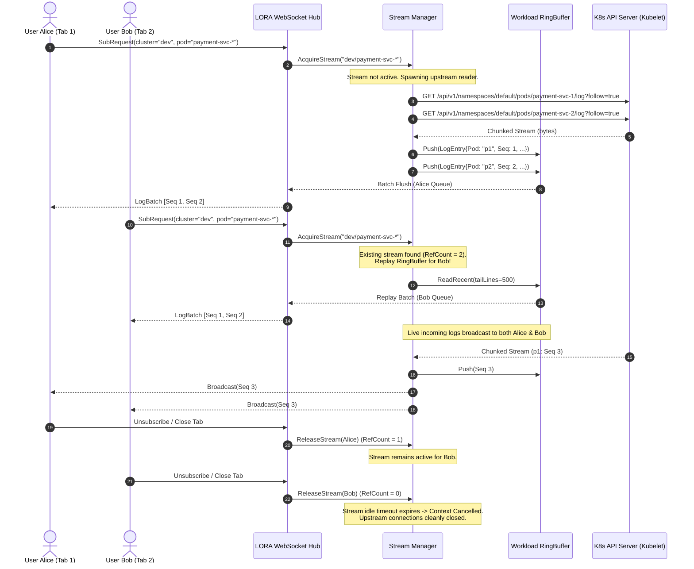
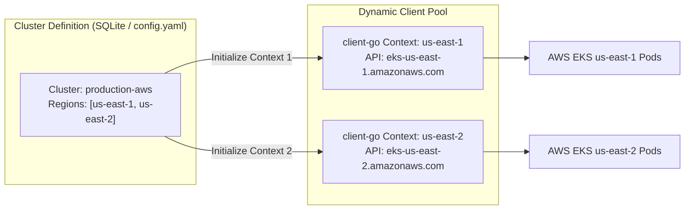
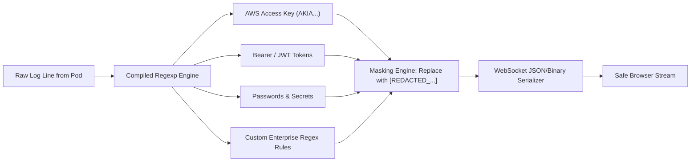

# LORA System Architecture & Technical Specifications

> **LORA** (Lightweight Observability & Real-time Analyzer) is a cloud-native, high-throughput Kubernetes log streaming and observability platform engineered for multi-cluster, dual-region enterprise environments.

---

## 1. High-Level System Architecture

LORA is packaged as a single self-contained binary containing both the high-concurrency Go backend and the compiled React 18 frontend assets (embedded via Go 1.16+ `embed.FS`). It connects directly to one or more Kubernetes API servers using standard `client-go` mechanisms (in-cluster ServiceAccount, ambient kubeconfig, or external credential helpers like `kconnect`).

```mermaid
flowchart TD
    subgraph Clients["Clients & Browsers"]
        UI1["User Browser A (Chrome/Firefox/Edge)"]
        UI2["User Browser B (Chrome/Firefox/Edge)"]
    end

    subgraph LORAServer["LORA Standalone Server (:8080)"]
        subgraph FrontendLayer["Embedded Frontend (React 18 + Vite)"]
            SPA["Single Page App (Tailwind CSS, Zustand, React-Virtual)"]
        end

        subgraph APILayer["HTTP & WebSocket Router (Chi Engine)"]
            HTTPAPI["REST API (/api/clusters, /api/health)"]
            WSHub["WebSocket Hub (/ws/logs, /ws/workload)"]
            AuthMod["Auth & RBAC Middleware"]
            Batcher["Frame Batcher (200ms Jitter/Flush)"]
        end

        subgraph CoreEngine["Streaming & Concurrency Core"]
            StreamMgr["Stream Manager (Ref-Counted Multiplexer)"]
            RingBuf["Per-Stream Memory RingBuffer (Zero-Alloc Slices)"]
            RedactEngine["Log Masking & Redaction Engine"]
            FanOut["Subscriber Fan-Out Broadcast Queues"]
        end

        subgraph StorageLayer["Persistence & Metadata"]
            SQLite["Embedded SQLite (WAL Mode, cluster metadata & settings)"]
        end
    end

    subgraph K8sInfrastructure["Kubernetes Infrastructure"]
        subgraph Region1["Region: us-east-1"]
            EKS1["Cluster A (us-east-1) API Server"]
            Pod1A["Pod: payment-svc-7dfb8-x1"]
            Pod1B["Pod: payment-svc-7dfb8-y2"]
        end

        subgraph Region2["Region: us-east-2"]
            EKS2["Cluster B (us-east-2) API Server"]
            Pod2A["Pod: order-svc-5cf99-z3"]
            Pod2B["Pod: auth-svc-2ea11-w4"]
        end
    end

    UI1 <-->|HTTP GET / Assets| HTTPAPI
    UI1 <-->|Bi-directional WebSocket (JSON/Binary Frames)| WSHub
    UI2 <-->|Bi-directional WebSocket (JSON/Binary Frames)| WSHub

    HTTPAPI --- StorageLayer
    WSHub --- StreamMgr
    StreamMgr --- RingBuf
    RingBuf --- RedactEngine
    RedactEngine --- FanOut
    FanOut --- Batcher
    Batcher --> WSHub

    StreamMgr -->|client-go Log Stream (SPDY/HTTP2)| EKS1
    StreamMgr -->|client-go Log Stream (SPDY/HTTP2)| EKS2
    EKS1 -.->|Kubelet Stream| Pod1A
    EKS1 -.->|Kubelet Stream| Pod1B
    EKS2 -.->|Kubelet Stream| Pod2A
    EKS2 -.->|Kubelet Stream| Pod2B
```

---

## 2. Multi-Pod Stream Multiplexing & Fan-Out Engine

When multiple users (or split-view tabs) inspect the same workload or container, LORA **never duplicates upstream Kubernetes API requests**. 

Instead, it employs an internal **Reference-Counted Multiplexing Stream Manager**:
1. **Upstream Deduping:** The first subscriber requesting `(cluster, namespace, pod, container)` initializes a single upstream `client-go` stream (`rest.Request.Stream(ctx)`).
2. **Ring Buffer Ingestion:** Log lines stream into an in-memory, thread-safe `RingBuffer` with bounded memory allocation.
3. **Multi-User Fan-Out:** Multiple connected subscribers attach non-blocking queues to the same upstream stream.
4. **App/Workload Grouping:** When a user requests logs for a multi-replica service (e.g. `payment-service` with 3 replicas), LORA merges lines from all pods into a unified stream, tagging each line with its pod name and container identity while sorting by monotonic sequence and timestamp.
5. **Zero Upstream Leak:** When all subscribers disconnect, upstream streams and background goroutines are cleanly terminated via context cancellation.



---

## 3. Dual-Region Cluster Context Architecture

In modern AWS EKS and cloud environments, a single account or cluster definition often encompasses multiple geographical regions (e.g. primary in `us-east-1` and secondary/failover in `us-east-2`).

LORA handles this without requiring users to register separate cluster configs or restart the daemon:
- **Unified Cluster Metadata:** A registered cluster carries optional region context maps (`regions: [us-east-1, us-east-2]`).
- **Dynamic Context Switching:** When switching regions in the Resource Explorer or Command Palette (`Ctrl + K`), LORA swaps the `rest.Config` context dynamically.
- **Cache Isolation:** Pod lists, namespace listings, and active streams are namespaced by `cluster_id + region_id` to prevent cross-region state collision.



---

## 4. Frontend Virtualization & Rendering Pipeline

High-velocity log streams can emit thousands of lines per second. Standard DOM rendering easily crashes browsers or causes severe frame stutter.

LORA solves this using a **Zero-Lag Virtualized Pipeline**:

```mermaid
flowchart LR
    subgraph WSReceive["WebSocket Stream"]
        RawFrames["WS Binary/JSON Stream"]
    end

    subgraph ZustandStore["Zustand State Store"]
        RingBufferClient["Client Ring Buffer (Max 50,000 lines)"]
        ActiveFilters["Active Filters (Regex, Inverse, Severity)"]
        FilteredLines["Memoized View Window"]
    end

    subgraph Virtualizer["TanStack Virtualizer (@tanstack/react-virtual)"]
        HeightCalculator["Dynamic Height Measurement (DOM MeasureElement)"]
        ViewportSlice["Render Window (Only ~35 visible rows in DOM)"]
    end

    subgraph DOM["DOM Tree"]
        Screen["Screen Display (60 FPS smooth scroll)"]
    end

    RawFrames --> RingBufferClient
    RingBufferClient --> ActiveFilters
    ActiveFilters --> FilteredLines
    FilteredLines --> HeightCalculator
    HeightCalculator --> ViewportSlice
    ViewportSlice --> DOM
    DOM --> Screen
```



### Key Frontend Architectural Components:
1. **Windowing & Virtualization:** Only 30–40 elements exist in the DOM tree at any given moment regardless of whether the buffer contains 500 or 50,000 lines.
2. **Auto-Scroll Locking:** Automatically follows the tail of the log stream if scrolled to the bottom; smoothly pauses autoscroll if the user scrolls up to inspect historical lines.
3. **Log Line Inspector:** Clicking any line un-docks the `LogDetailPanel`, formatting embedded JSON strings, extracting stack traces, and offering 1-click PNG image export.
4. **Permalinking & Deep Linking:** Log entries can be shared with teammates using URL hashes `#pod=<name>&container=<name>&seq=<num>`, restoring tab context, position, and line selection on page load.

---

## 5. Security & Redaction Pipeline

Logs frequently contain sensitive tokens, API credentials, and personal data. LORA executes sanitization **before** broadcast frames leave the server:



### Security Highlights:
- **No Disk Logging:** Streamed logs flow through memory buffers and are never written to unencrypted temporary files on the host disk.
- **Minimal RBAC:** The LORA service only requires Kubernetes `get`, `list`, and `watch` permissions on `pods` and `pods/log`.
- **TLS & WSS Ready:** Native support for reverse proxies terminating TLS (Nginx, Traefik, AWS ALB) with seamless WebSocket connection upgrading.

