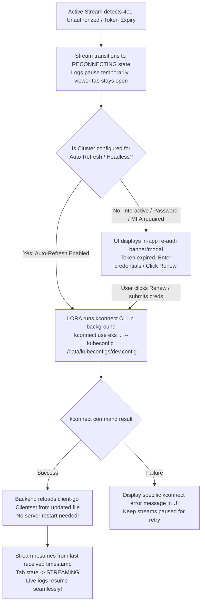

# LORA — Complete Technical Implementation Plan & Progress Tracker

> **Document Status:** Master Implementation Blueprint (Locked)  
> **Target Audience:** Developers, DevOps Engineers, and Autonomous AI Coding Agents  
> **Primary Rule for AI Agents:** Every task is broken down with file targets, types, APIs, and verification steps. Do not alter data contracts or remove safety buffers without explicit permission.

---

## Table of Contents
1. [System Overview & Architecture Decisions](#1-system-overview--architecture-decisions)
2. [Complete Technology Stack & Dependencies](#2-complete-technology-stack--dependencies)
3. [Configuration Schema & Environment Setup](#3-configuration-schema--environment-setup)
4. [Master Progress Tracker (Phase-by-Phase Checklist)](#4-master-progress-tracker-phase-by-phase-checklist)
5. [Detailed REST API Specifications](#5-detailed-rest-api-specifications)
6. [WebSocket Protocol Specification](#6-websocket-protocol-specification)
7. [Core Backend Components & Data Structures](#7-core-backend-components--data-structures)
8. [Kconnect & Kubeconfig Authentication Lifecycle](#8-kconnect--kubeconfig-authentication-lifecycle)
9. [Frontend Component & State Architecture](#9-frontend-component--state-architecture)
10. [Step-by-Step AI Agent Execution Guide](#10-step-by-step-ai-agent-execution-guide)
11. [Verification, Edge Cases & Acceptance Criteria](#11-verification-edge-cases--acceptance-criteria)

---

## 1. System Overview & Architecture Decisions

### 1.1 Core Mission
LORA is a self-hosted Kubernetes log streaming tool designed to provide engineers with immediate, low-latency log inspection directly from Amazon EKS clusters without being subjected to sampling or ingest limits imposed by external SaaS platforms.

### 1.2 Two-Stage Phased Roadmap
* **Version 1 (V1 - Base MVP):** Local Windows/Linux execution, multiple EKS clusters connected via user-supplied `kubeconfig` files (generated via `kconnect`), shared K8s streaming fan-out, virtualized React log viewer, independent tabs, search/pause/export, and in-memory connection monitoring.
* **Version 2 (V2 - Platform Release):** Multi-container merge, dynamic pod groups with K8s watch, Azure AD (Entra ID) OIDC SSO, admin permission workflow, log redaction patterns, pod events panel, and on-demand S3 export.

### 1.3 Core Invariant (The Fan-Out Principle)
```text
  1 Target Pod/Container Stream (Kubernetes API via client-go)
                            │
                            ▼
          1 Shared Backend Connection (PodConnection)
         ┌──────────────────┴──────────────────┐
         ▼                                     ▼
Subscriber Queue A (User 1 - Tab 1)   Subscriber Queue B (User 2 - Tab 3)
         │                                     │
         ▼ (WebSocket)                         ▼ (WebSocket)
    Browser Tab 1                         Browser Tab 2
  [Filter: ERROR only]                 [Filter: No filter]
```
* **Never** open multiple Kubernetes API log streams for the same target pod, container, and configuration.
* **Never** block the shared stream reader if a single subscriber is slow or paused.
* **Key Pods by Pod UID**, never pod name alone, to prevent pod recreation race conditions.

### 1.4 UI-First Configuration & Zero-Cluster Startup
* **Zero-Cluster Graceful Boot:** If no configuration file or 0 clusters exist, LORA boots up normally, serves the web UI, and displays an onboarding screen allowing users to configure clusters via forms.
* **Full UI Configuration Control:** All cluster definitions (names, environments, kubeconfig modes, and kconnect arguments) and server/streaming parameters can be added, updated, tested, and deleted directly in the browser.
* **Dual Persistence:** Configuration changes in the UI are atomically saved to both SQLite (`app_settings` table) and the disk file (`lora-config.yaml`).
* **Hot-Reload & In-App Restart:** Adding or editing clusters takes effect dynamically in-memory without server restart; an in-app "Restart Server" action is available whenever full process restart is desired.

---

## 2. Complete Technology Stack & Dependencies

### 2.1 Backend (Go 1.22+)
* **Runtime:** Standard Go toolchain (Windows amd64 / Linux amd64)
* **HTTP Router:** `github.com/go-chi/chi/v5` (v5.0.12+) — lightweight, standard `net/http` compatible.
* **WebSocket:** `nhooyr.io/websocket` (v1.8.11+) — context-aware, native cancellation, zero goroutine leaks.
* **Kubernetes Client:** `k8s.io/client-go` (v0.30.0+) and `k8s.io/apimachinery` — native API interactions.
* **Deduplication:** `golang.org/x/sync/singleflight` — race-free connection initialization.
* **Database (Settings & Metadata):** `modernc.org/sqlite` (v1.29.0+) — pure Go SQLite driver (no CGO required).
* **Configuration:** `gopkg.in/yaml.v3` — strict YAML parsing.
* **Structured Logging:** Go standard library `log/slog`.
* **CORS:** `github.com/go-chi/cors`.

### 2.2 Frontend (React 18+ / TypeScript 5+)
* **Build System:** Vite (`vite` 5.x)
* **Language:** TypeScript 5.4+ with strict mode enabled
* **Virtualization:** `@tanstack/react-virtual` (v3.5.0+) — handles 50,000+ log lines with variable row heights.
* **State Management:** `zustand` (v4.5.0+) — micro-stores for viewer tabs, connection status, settings.
* **Styling:** `tailwindcss` (v3.4.0+), `clsx`, `tailwind-merge`
* **Icons:** `lucide-react`
* **Date Utilities:** `date-fns` (v3.6.0+)
* **UI Component Primitives:** Radix UI primitives via Shadcn UI patterns (dialog, dropdown, tooltip, tabs).

---

## 3. Configuration Schema & Environment Setup

### 3.1 File Location
Default configuration path: `./configs/lora-config.yaml` (overridable via `LORA_CONFIG_PATH` env var).

### 3.2 Canonical `lora-config.yaml`
```yaml
server:
  host: "0.0.0.0"
  port: 8080
  cors_origins:
    - "http://localhost:5173"
    - "http://127.0.0.1:5173"

database:
  path: "./data/lora.db"

clusters:
  - id: "dev"
    name: "Development Cluster"
    environment: "development"
    managed_kubeconfig: true # LORA automatically manages file at ./data/kubeconfigs/dev.config
    kubeconfig:
      path: "" # Leave empty if managed_kubeconfig is true, or specify custom path
      context: ""
    kconnect:
      enabled: true
      command: "kconnect" # Path to kconnect executable or in system PATH
      args:
        - "use"
        - "eks"
        - "--cluster"
        - "dev-eks-cluster"
      auto_refresh: true # Automatically runs kconnect when token expires
      env:
        AWS_REGION: "ap-south-1"
    health_check_interval: "30s"
    enabled: true

  - id: "staging"
    name: "Staging Cluster"
    environment: "staging"
    managed_kubeconfig: true
    kubeconfig:
      path: ""
      context: ""
    kconnect:
      enabled: true
      command: "kconnect"
      args:
        - "use"
        - "eks"
        - "--cluster"
        - "staging-eks-cluster"
      auto_refresh: true
    health_check_interval: "30s"
    enabled: true

  - id: "prod"
    name: "Production Cluster"
    environment: "production"
    managed_kubeconfig: true
    kubeconfig:
      path: ""
      context: ""
    kconnect:
      enabled: true
      command: "kconnect"
      args:
        - "use"
        - "eks"
        - "--cluster"
        - "prod-eks-cluster"
      auto_refresh: false # Requires explicit user click/confirmation in UI before renewing prod token
    health_check_interval: "60s"
    enabled: true

streaming:
  default_tail_lines: 500
  ring_buffer_max_entries: 1000
  ring_buffer_max_bytes: 2097152 # 2 MB per stream
  total_memory_budget: 209715200 # 200 MB global buffer limit
  subscriber_queue_size: 500
  max_streams_per_user: 5
  max_subscribers_per_stream: 50

websocket:
  batch_interval_ms: 200
  max_message_size: 262144 # 256 KB
  heartbeat_interval_s: 30

viewer:
  max_tabs_soft_limit: 10
  max_tabs_hard_limit: 20
  pause_queue_max_entries: 5000
  pause_queue_max_bytes: 5242880 # 5 MB
  client_max_log_lines: 50000

display:
  default_theme: "dark"
  default_timestamp_format: "local_absolute"
```

---

## 4. Master Progress Tracker (Phase-by-Phase Checklist)

Any autonomous agent or developer working on this project must check off tasks in this list as they are completed.

### Phase 1: Project Scaffolding & Configuration
- [x] Initialize Go module (`go mod init lora`)
- [x] Configure directory structure (`cmd/lora`, `internal/...`, `frontend/...`, `configs/...`, `data/`)
- [x] Implement `internal/config/config.go` (YAML parsing, validation, path normalization)
- [x] Implement `internal/logging/logger.go` with structured `log/slog` output
- [x] Implement `internal/database/db.go` with pure-Go SQLite initialization, WAL mode, migrations
- [x] Create `internal/database/migrations/001_initial.sql` for `app_settings`
- [x] Implement basic HTTP server in `cmd/lora/main.go` with Chi router, CORS, and health endpoints (`/healthz`, `/readyz`)
- [x] Verify Go compilation and local health check response on Windows

### Phase 2: Kubeconfig Loading & Cluster Client Manager
- [x] Implement `internal/cluster/kubeconfig.go` (safe path resolution, validation of kubeconfig on Windows)
- [x] Implement `internal/cluster/client.go` (wrapping `client-go/kubernetes`, `clientcmd.BuildConfigFromFlags`)
- [x] Implement `internal/cluster/health.go` (background periodic ping `discoveryClient.ServerVersion()`)
- [x] Implement `internal/cluster/manager.go` (lifecycle, cluster map, thread-safe reload)
- [x] Implement `POST /api/v1/clusters/{id}/reconnect` to reload updated kubeconfigs on the fly
- [x] Unit tests for multi-cluster configuration and safe reloading

### Phase 3: Kubernetes Resource Discovery API
- [x] Implement `internal/kubernetes/namespaces.go` (list namespaces with context timeout)
- [x] Implement `internal/kubernetes/pods.go` (list pods, extract status, phase, restart counts, age, Pod UID)
- [x] Implement `internal/kubernetes/containers.go` (list regular, init, and previous container states)
- [x] Implement REST handlers in `internal/api/handlers/`:
  - [x] `GET /api/v1/clusters`
  - [x] `GET /api/v1/clusters/{id}/namespaces`
  - [x] `GET /api/v1/clusters/{id}/namespaces/{ns}/pods`
  - [x] `GET /api/v1/clusters/{id}/namespaces/{ns}/pods/{pod}/containers`
- [x] Handle Kubernetes 401 Unauthorized errors and map to `CLUSTER_AUTH_EXPIRED` structured error

### Phase 4: Single-Pod Log Streaming (WebSocket)
- [x] Implement `internal/kubernetes/logs.go` using `corev1.PodLogOptions` (`Follow: true`, `TailLines: 500`, `Timestamps: true`)
- [x] Support `Previous: true` container logs
- [x] Implement `internal/streaming/protocol.go` (JSON payloads for WS messages)
- [x] Implement `internal/streaming/websocket.go` (`nhooyr.io/websocket` upgrader, read/write loops, ping/pong heartbeat)
- [x] Create basic direct streaming pipeline from pod reader to WebSocket client
- [x] Test end-to-end streaming against a live pod using a CLI test client or Postman

### Phase 5: Shared Connection Manager & Fan-Out Engine
- [x] Implement `internal/connection/key.go` with normalized stream key generation:
  `Key = fmt.Sprintf("%s:%s:%s:%s:prev=%t", clusterID, ns, podUID, container, previous)`
- [x] Implement `internal/connection/buffer.go` (circular ring buffer capped by 1,000 entries and 2MB)
- [x] Implement `internal/connection/subscriber.go` (subscriber representation, bounded channel `chan LogEntry`, drop detection)
- [x] Implement `internal/connection/broadcaster.go` (fan-out loop with non-blocking sends and drop counter)
- [x] Implement `internal/connection/manager.go` using `singleflight.Group` to prevent duplicate concurrent K8s requests
- [x] Implement safe teardown: when subscribers reach 0, cancel K8s context and release resources
- [x] Concurrency unit tests with Go race detector (`go test -race ./internal/connection/...`)

### Phase 6: Frontend Shell & Resource Explorer
- [x] Initialize React + TypeScript project with Vite in `./frontend`
- [x] Configure Tailwind CSS and dark/light theme provider
- [x] Create layout: Header (cluster badge, theme toggle), Sidebar (explorer), Main Pane (viewer/admin)
- [x] Implement `ClusterSelector.tsx` with live status indicator (🟢 Running / 🔴 Auth Expired / 🟡 Unreachable)
- [x] Implement `NamespaceSelector.tsx` with quick filter search
- [x] Implement `PodList.tsx` displaying:
  - Pod Name
  - Status badge (Running, CrashLoop, Pending)
  - Restart count (highlighting non-zero)
  - Age / creation timestamp
- [x] Implement `ContainerList.tsx` with container selector and "Previous logs" toggle
- [x] Wire up REST API client with Axios or native `fetch` in `src/lib/api.ts`

### Phase 7: Virtualized Log Viewer & Control Toolbar
- [x] Integrate `@tanstack/react-virtual` in `LogViewer.tsx` for row virtualization
- [x] Implement batch rendering accumulator (flushing incoming WS lines on a 100-250ms cadence)
- [x] Implement `LogLine.tsx` with syntax highlighting (ERROR = red, WARN = yellow, INFO = blue/green)
- [x] Implement Auto-scroll toggle:
  - If user is pinned to bottom, keep auto-scrolling
  - If user scrolls up, disable auto-scroll and render "↓ N new lines" indicator
- [x] Implement `LogToolbar.tsx`:
  - Instant client-side text search with match counter
  - Pause / Resume toggle button
  - Clear local display buffer button
  - Copy all / selected lines
  - Export to `.log` file
- [x] Implement Pause Local Queue: buffer up to 5,000 lines during pause; show warning if overflow occurs

### Phase 8: Multi-Tab Viewer System
- [x] Implement Zustand `viewerStore.ts`:
  - Manage active tab array: `id`, `title`, `clusterId`, `namespace`, `podName`, `container`, `isPrevious`, `filterQuery`, `isPaused`
  - Active tab pointer
- [x] Implement `TabBar.tsx` with tab switching, closing, and new tab creation
- [x] Multiplex subscriptions over single WebSocket connection using `viewer_id` routing
- [x] Enforce soft limit (10 tabs warning banner) and hard limit (max 20 tabs)

### Phase 9: Admin Screens & Operational Polish
- [x] Implement `ConnectionMonitor.tsx` (`/admin/connections`):
  - Table of active shared K8s streams
  - Subscriber count per stream
  - Current lines/sec and bytes/sec rate
  - Dropped entries per subscriber
  - Total memory consumption estimate
- [x] Implement `SettingsPanel.tsx` (`/admin/settings`):
  - Form editing buffer limits, default tail lines, batch windows, max tabs
  - Persist updates to SQLite database via `PUT /api/v1/admin/settings`
- [x] Implement Token Expiry Modal & Reconnect Trigger:
  - Banner warning: "Authentication expired for cluster [name]"
  - Action button: "Reconnect" (triggers `POST /api/v1/clusters/{id}/reconnect`)
- [x] Keyboard shortcuts: `Ctrl+F` (search), `Space` (pause), `Ctrl+End` (bottom), `Ctrl+Shift+T` (new tab), `Ctrl+W` (close tab)
- [x] Final end-to-end integration verification

### Phase 10: V2 Unified Capabilities (Optional Enablement & Platform Polish)
- [x] Unified V1 + V2 Configuration Schema (`internal/config/config.go`):
  - `auth`: Azure AD (Entra ID) / OIDC with toggle (`auth.enabled: false` default)
  - `s3_export`: S3 bucket, region, prefix, ambient IAM role / access keys (`s3_export.enabled: false` default)
  - `redaction`: regex masking rules with live tester sandbox (`redaction.enabled: false` default)
  - `features`: multi-container merge, pod groups, pod events toggles
- [x] V2 Multi-Container Log Streaming & Merging (`internal/kubernetes/logs.go`):
  - Stream all containers concurrently when container is `_all_` or comma-separated
  - Synchronized sequence number and timestamp interleaving
  - Frontend "All Containers (Merged)" button and container badge chips in `LogLine.tsx`
- [x] V2 Kubernetes Pod Events API & Panel (`internal/kubernetes/events.go`):
  - Endpoint `GET /api/v1/clusters/{id}/namespaces/{ns}/pods/{pod}/events`
  - Collapsible Pod Events Drawer in `LogViewer.tsx` with severity chips, count, and refresh
- [x] V2 Log Redaction & Masking Engine (`internal/redaction/redactor.go`):
  - Regex-based masking for AWS keys, bearer tokens, passwords
  - Admin test sandbox endpoint `POST /api/v1/admin/redaction/test`
- [x] V2 On-Demand S3 Log Export (`internal/export/s3.go`):
  - Pure-Go AWS SigV4 signed PUT object with automatic gzip compression
  - Endpoint `POST /api/v1/clusters/{id}/namespaces/{ns}/pods/{pod}/export-s3`
  - "S3" button in `LogToolbar.tsx` with notification banner
- [x] V2 Azure AD (Entra ID) / OIDC Authentication Module (`internal/auth/auth.go`):
  - HMAC-SHA256 JWT sessions and cookie middleware
  - Non-blocking: when disabled, defaults to `Local Administrator` transparently
  - User session badge & sign-in/sign-out controls in `Header.tsx`
- [x] Comprehensive Tabbed Admin Settings UI (`SettingsModal.tsx`):
  - General & Buffering, Azure AD / SSO, AWS S3 Export, Data Redaction (with live tester), Server Operations
  - Wider container (`max-w-4xl`), 2-column responsive grid layout, and fixed pinned footer save bar
- [x] Single-binary re-compilation with embedded React 18 production bundle (`bin/lora.exe`)
- [x] Cross-platform Linux Support:
  - Cross-compiled native static Linux ELF binary (`bin/lora-linux-amd64`)
  - Multi-stage production `Dockerfile` with embedded `kubectl` and static asset bundling
  - `docker-compose.yaml` and systemd unit (`lora.service`) for VM deployments

### Phase 11: Enterprise Productivity & Advanced Log Investigation
- [ ] Log Detail Side Panel (Slide-over Inspector):
  - Auto-detection & extraction of embedded JSON payloads
  - Syntax-highlighted JSON viewer with expandable/collapsible trees & color-coded types
  - Raw log vs Pretty JSON toggle view
  - Action buttons: Copy Raw, Copy JSON, and **Copy JSON as Image** (theme-aware HTML5 canvas to PNG clipboard export)
  - Pod & container metadata header with direct navigation
- [ ] Pod Grouping & Multi-Pod Merged Streaming:
  - Automatic pod grouping by deployment/app prefix (e.g. `payment-service-*`) in Resource Explorer
  - Single-click "Stream All Pods (Merged)" for multi-replica deployments
  - Pod badge chips in `LogLine.tsx` distinguishing replicas in merged streams
  - Backend multi-pod streaming multiplexer (`StreamPodGroupLogs`)
- [ ] Time-Range Tail Filtering & On-Demand Historical Chunks:
  - Time window selector in `LogToolbar`: Default **Last 15m** (options: 5m, 15m, 30m, 1h, 6h, 24h, All)
  - Backend support for `corev1.PodLogOptions.SinceSeconds` (900s for 15m)
  - Prevents pulling thousands of stale lines from days prior on initial connect
- [ ] JSON Lines (.jsonl) Export Option in Log Toolbar

---

## 5. Detailed REST API Specifications

All endpoints prefix: `/api/v1`

### 5.1 System Health
* **`GET /healthz`**  
  * **Response `200 OK`:** `{"status": "ok"}`
* **`GET /readyz`**  
  * **Response `200 OK`:** `{"ready": true, "clusters_online": 3, "clusters_total": 3}`  
  * **Response `503 Service Unavailable`:** `{"ready": false, "reason": "No clusters available"}`

### 5.2 Clusters
* **`GET /api/v1/clusters`**
  * **Response `200 OK`:**
    ```json
    [
      {
        "id": "dev",
        "name": "Development Cluster",
        "environment": "development",
        "status": "HEALTHY",
        "last_checked": "2026-11-01T01:50:00Z",
        "error_message": null
      },
      {
        "id": "prod",
        "name": "Production Cluster",
        "environment": "production",
        "status": "AUTH_EXPIRED",
        "last_checked": "2026-11-01T01:50:00Z",
        "error_message": "Unauthorized: kconnect token expired"
      }
    ]
    ```

* **`POST /api/v1/clusters`**
  * **Description:** Dynamically add a new Kubernetes cluster via UI form. Persists to `lora-config.yaml` and initializes connection in-memory.
  * **Request Body:**
    ```json
    {
      "id": "prod-us",
      "name": "Production US EKS",
      "environment": "production",
      "managed_kubeconfig": true,
      "kconnect": {
        "enabled": true,
        "command": "kconnect",
        "args": ["use", "eks", "--cluster", "prod-us-eks"],
        "auto_refresh": false
      },
      "enabled": true
    }
    ```
  * **Response `200 OK`:**
    ```json
    {
      "success": true,
      "cluster": {
        "id": "prod-us",
        "name": "Production US EKS",
        "status": "HEALTHY"
      }
    }
    ```

* **`PUT /api/v1/clusters/{id}`**
  * **Description:** Update existing cluster settings dynamically.

* **`DELETE /api/v1/clusters/{id}`**
  * **Description:** Remove cluster from configuration and release resources.

* **`GET /api/v1/clusters/{id}/config`**
  * **Description:** Get raw configuration for editing in the UI form.

* **`POST /api/v1/admin/restart`**
  * **Description:** Gracefully restart the backend server process.

* **`POST /api/v1/clusters/{id}/reconnect`**
  * **Description:** Forces backend to reload the specified cluster's kubeconfig file from disk and refresh client.
  * **Response `200 OK`:**
    ```json
    {
      "success": true,
      "cluster_id": "prod",
      "status": "HEALTHY",
      "message": "Kubeconfig reloaded and connectivity verified"
    }
    ```
  * **Response `401 Unauthorized`:**
    ```json
    {
      "success": false,
      "cluster_id": "prod",
      "status": "AUTH_EXPIRED",
      "error": "Token is still invalid or expired. Please re-run kconnect."
    }
    ```

### 5.3 Namespaces
* **`GET /api/v1/clusters/{id}/namespaces`**
  * **Response `200 OK`:**
    ```json
    {
      "cluster_id": "dev",
      "namespaces": ["default", "kube-system", "payments", "auth-service", "frontend"]
    }
    ```

### 5.4 Pods
* **`GET /api/v1/clusters/{id}/namespaces/{ns}/pods`**
  * **Response `200 OK`:**
    ```json
    {
      "cluster_id": "dev",
      "namespace": "payments",
      "pods": [
        {
          "name": "payment-api-79b8c6f669-x1y2z",
          "uid": "c3d4e5f6-789a-bcde-f012-3456789abcde",
          "phase": "Running",
          "ready": true,
          "restart_count": 0,
          "created_at": "2026-10-30T10:15:00Z",
          "containers": ["payment-server", "envoy-proxy"]
        },
        {
          "name": "worker-queue-5f6d7c8b9a-9z8y7",
          "uid": "12345678-abcd-ef01-2345-6789abcdef01",
          "phase": "CrashLoopBackOff",
          "ready": false,
          "restart_count": 14,
          "created_at": "2026-10-31T22:00:00Z",
          "containers": ["worker"]
        }
      ]
    }
    ```

### 5.5 Containers
* **`GET /api/v1/clusters/{id}/namespaces/{ns}/pods/{pod}/containers`**
  * **Response `200 OK`:**
    ```json
    {
      "pod_name": "payment-api-79b8c6f669-x1y2z",
      "containers": [
        {
          "name": "payment-server",
          "state": "running",
          "restarts": 0,
          "has_previous": false
        },
        {
          "name": "envoy-proxy",
          "state": "running",
          "restarts": 1,
          "has_previous": true
        }
      ]
    }
    ```

### 5.6 Admin Connection Monitor
* **`GET /api/v1/admin/connections`**
  * **Response `200 OK`:**
    ```json
    {
      "total_active_streams": 2,
      "total_subscribers": 3,
      "memory_usage_bytes": 4512000,
      "streams": [
        {
          "key": "prod:payments:c3d4e5f6...:payment-server:prev=false",
          "cluster_id": "prod",
          "namespace": "payments",
          "pod_name": "payment-api-79b8c6f669-x1y2z",
          "container": "payment-server",
          "subscribers_count": 2,
          "lines_per_second": 45.2,
          "bytes_per_second": 18240,
          "buffer_entries": 1000,
          "state": "RUNNING",
          "created_at": "2026-11-01T01:30:00Z"
        }
      ]
    }
    ```

### 5.7 Admin Settings
* **`GET /api/v1/admin/settings`** & **`PUT /api/v1/admin/settings`**
  * Request/Response JSON mirrors the `streaming`, `websocket`, `viewer`, and `display` configuration fields.

### 5.8 Kconnect Command Execution & Automation
* **`POST /api/v1/clusters/{id}/kconnect/execute`**
  * **Description:** Executes `kconnect` for the specified cluster, writes credentials to the LORA-managed kubeconfig file, and reloads client-go.
  * **Request Body (Optional):**
    ```json
    {
      "password": "optional_secure_password",
      "mfa_code": "optional_mfa_code",
      "extra_args": ["--alias", "dev-alias"]
    }
    ```
  * **Response `200 OK`:**
    ```json
    {
      "success": true,
      "cluster_id": "dev",
      "output": "Configuration written to ./data/kubeconfigs/dev.config\nContext set successfully.",
      "status": "HEALTHY",
      "duration_ms": 1420
    }
    ```
  * **Response `401 / 500 Error`:**
    ```json
    {
      "success": false,
      "cluster_id": "dev",
      "error": "Authentication failed: invalid MFA token or credentials",
      "stderr": "kconnect: error: invalid credentials provided"
    }
    ```

* **`GET /api/v1/clusters/{id}/kconnect/config`**
  * **Response `200 OK`:**
    ```json
    {
      "cluster_id": "dev",
      "command": "kconnect",
      "args": ["use", "eks", "--cluster", "dev-eks-cluster"],
      "managed_kubeconfig_path": "./data/kubeconfigs/dev.config",
      "auto_refresh": true,
      "last_executed": "2026-11-01T06:30:00Z"
    }
    ```

---

## 6. WebSocket Protocol Specification

* **Endpoint:** `ws://<host>:8080/ws/v1/logs`
* **Transport:** JSON-encoded UTF-8 text frames.

### 6.1 Client -> Server Messages

#### Subscribe to Pod Container Stream
```json
{
  "type": "subscribe",
  "request_id": "req-101",
  "viewer_id": "tab-uuid-1234",
  "cluster_id": "dev",
  "namespace": "payments",
  "pod_name": "payment-api-79b8c6f669-x1y2z",
  "container": "payment-server",
  "previous": false,
  "tail_lines": 500,
  "timestamps": true
}
```

#### Unsubscribe
```json
{
  "type": "unsubscribe",
  "request_id": "req-102",
  "viewer_id": "tab-uuid-1234"
}
```

#### Client Ping
```json
{
  "type": "ping",
  "timestamp": 1730425800000
}
```

### 6.2 Server -> Client Messages

#### Subscription Acknowledged
```json
{
  "type": "subscription.created",
  "request_id": "req-101",
  "viewer_id": "tab-uuid-1234",
  "pod_uid": "c3d4e5f6-789a-bcde-f012-3456789abcde",
  "status": "RUNNING",
  "replay_count": 350
}
```

#### Batched Log Entries
```json
{
  "type": "logs",
  "viewer_id": "tab-uuid-1234",
  "entries": [
    {
      "seq": 1001,
      "timestamp": "2026-11-01T01:52:10.124Z",
      "pod_name": "payment-api-79b8c6f669-x1y2z",
      "container": "payment-server",
      "message": "INFO [com.pay.Service] Transaction approved: id=tx-9921",
      "stream": "stdout"
    },
    {
      "seq": 1002,
      "timestamp": "2026-11-01T01:52:10.125Z",
      "pod_name": "payment-api-79b8c6f669-x1y2z",
      "container": "payment-server",
      "message": "ERROR [com.pay.Webhook] Webhook endpoint timeout to merchant=m-44",
      "stream": "stderr"
    }
  ]
}
```

#### Subscription Error / Failure
```json
{
  "type": "subscription.error",
  "viewer_id": "tab-uuid-1234",
  "code": "POD_NOT_FOUND",
  "message": "Pod payment-api-79b8c6f669-x1y2z has terminated"
}
```

#### Buffer Gap / Truncation Warning
```json
{
  "type": "logs.gap",
  "viewer_id": "tab-uuid-1234",
  "dropped_entries": 420,
  "reason": "Client queue overflow while paused or slow consumer"
}
```

#### Server Pong / Heartbeat
```json
{
  "type": "pong",
  "timestamp": 1730425800000
}
```

---

## 7. Core Backend Components & Data Structures

### 7.1 Stream Key Normalization (`internal/connection/key.go`)
```go
package connection

import (
	"fmt"
)

type StreamKeyParams struct {
	ClusterID string
	Namespace string
	PodUID    string
	Container string
	Previous  bool
}

func GenerateStreamKey(p StreamKeyParams) string {
	return fmt.Sprintf("%s:%s:%s:%s:prev=%t", p.ClusterID, p.Namespace, p.PodUID, p.Container, p.Previous)
}
```

### 7.2 Log Ring Buffer (`internal/connection/buffer.go`)
```go
package connection

import (
	"sync"
	"time"
)

type LogEntry struct {
	Sequence  uint64    `json:"seq"`
	Timestamp time.Time `json:"timestamp"`
	PodName   string    `json:"pod_name"`
	Container string    `json:"container"`
	Message   string    `json:"message"`
	Stream    string    `json:"stream"`
}

type LogRingBuffer struct {
	mu         sync.RWMutex
	entries    []LogEntry
	maxEntries int
	maxBytes   int
	totalBytes int
	head       int
	isFull     bool
	overwrites uint64
}

func NewLogRingBuffer(maxEntries, maxBytes int) *LogRingBuffer {
	return &LogRingBuffer{
		entries:    make([]LogEntry, maxEntries),
		maxEntries: maxEntries,
		maxBytes:   maxBytes,
	}
}

func (b *LogRingBuffer) Push(entry LogEntry) {
	b.mu.Lock()
	defer b.mu.Unlock()

	entryBytes := len(entry.Message) + 64 // Approximate overhead
	if b.isFull {
		oldEntry := b.entries[b.head]
		b.totalBytes -= len(oldEntry.Message) + 64
		b.overwrites++
	}

	b.entries[b.head] = entry
	b.totalBytes += entryBytes
	b.head = (b.head + 1) % b.maxEntries

	if b.head == 0 {
		b.isFull = true
	}
}

func (b *LogRingBuffer) Snapshot() []LogEntry {
	b.mu.RLock()
	defer b.mu.RUnlock()

	if !b.isFull {
		result := make([]LogEntry, b.head)
		copy(result, b.entries[:b.head])
		return result
	}

	result := make([]LogEntry, b.maxEntries)
	copy(result, b.entries[b.head:])
	copy(result[b.maxEntries-b.head:], b.entries[:b.head])
	return result
}
```

### 7.3 Shared Pod Connection (`internal/connection/connection.go`)
```go
package connection

import (
	"context"
	"sync"
	"time"
)

type ConnectionState string

const (
	StateStarting     ConnectionState = "STARTING"
	StateRunning      ConnectionState = "RUNNING"
	StateReconnecting ConnectionState = "RECONNECTING"
	StateStopping     ConnectionState = "STOPPING"
	StateStopped      ConnectionState = "STOPPED"
	StateFailed       ConnectionState = "FAILED"
)

type Subscriber struct {
	ViewerID  string
	Queue     chan LogEntry
	Dropped   uint64
	IsPaused  bool
	CloseOnce sync.Once
}

type PodConnection struct {
	Key         string
	ClusterID   string
	Namespace   string
	PodName     string
	PodUID      string
	Container   string
	Previous    bool

	mu          sync.RWMutex
	subscribers map[string]*Subscriber
	buffer      *LogRingBuffer
	state       ConnectionState

	cancelFunc  context.CancelFunc
	createdAt   time.Time
}
```

---

## 8. Automated Kconnect Execution, Self-Managed Kubeconfigs & Seamless Token Renewal

### 8.1 Core Principle: Never Restart LORA on Token Expiry
When an EKS token expires:
1. **LORA must NOT be restarted.**
2. **Active viewer tabs must NOT be closed.**
3. **Log history already received in the browser must NOT be lost.**
4. **Kubeconfig file paths are managed automatically by LORA** in `./data/kubeconfigs/{cluster-id}.config`.

### 8.2 Two Re-Authentication Modes



### 8.3 Self-Managed Kubeconfig Storage
Instead of forcing the user to manually name and track separate kubeconfig files:
* When `managed_kubeconfig: true` is set, LORA assigns each cluster its own deterministic path:
  `./data/kubeconfigs/{clusterID}.config`
* When running `kconnect`, LORA automatically appends `--kubeconfig ./data/kubeconfigs/{clusterID}.config`.
* Kubeconfigs are isolated per cluster, preventing context collision.
* The directory `./data/kubeconfigs/` is created on startup and git-ignored.

### 8.4 Automated `kconnect` Execution Engine (`internal/cluster/runner.go`)
LORA provides a built-in process runner that executes `kconnect.exe` or `kubectl.exe` directly on the host:
* **Command Template:**
  ```text
  kconnect use eks --cluster <cluster_name> --kubeconfig ./data/kubeconfigs/<cluster_id>.config [additional_args...]
  ```
* **Credential Injection:** Credentials (such as username, profile, or identity provider flags) can be passed as arguments or injected securely via standard environment variables (e.g. `AWS_PROFILE`, `KCONNECT_USERNAME`, `KCONNECT_PASSWORD`).
* **Execution Timeout:** Each execution has a strict 30-second timeout with stdout/stderr capture for immediate debugging in the LORA UI.

### 8.5 Seamless In-Flight Stream Recovery
When a cluster's authentication expires while multiple users/tabs are actively streaming:
1. The shared `PodConnection` enters `StateReconnecting`.
2. Existing subscribers remain attached; their queues are preserved.
3. The WebSocket hub emits a message:
   ```json
   {
     "type": "stream.status",
     "viewer_id": "tab-1234",
     "status": "RECONNECTING",
     "message": "Token expired. Renewing session via kconnect..."
   }
   ```
4. The frontend shows a subtle status pill: `🟡 Reconnecting session...`
5. LORA runs the `kconnect` command. Once the kubeconfig is refreshed, the backend establishes a fresh Kubernetes log stream using `SinceTime: lastEntryTimestamp`.
6. Live logs begin flowing again. The frontend automatically switches to `🟢 Streaming`.
7. **Zero log loss, zero tab disruption, zero server restarts.**

### 8.6 Dedicated Kconnect API Endpoints
* **`POST /api/v1/clusters/{id}/kconnect/execute`**
  * Manually or automatically trigger `kconnect` for the specified cluster.
  * Optional request body:
    ```json
    {
      "password": "optional_secure_input",
      "mfa_code": "optional_mfa_code"
    }
    ```
  * Returns execution logs and updated cluster health status.
* **`GET /api/v1/clusters/{id}/kconnect/config`**
  * Inspect the configured command, arguments, and auto-refresh schedule for the cluster.

---

## 9. Frontend Component & State Architecture

### 9.1 Zustand Store: `viewerStore.ts`
```typescript
export interface ViewerTab {
  id: string;
  clusterId: string;
  namespace: string;
  podName: string;
  container: string;
  isPrevious: boolean;
  filterText: string;
  isPaused: boolean;
  autoScroll: boolean;
  unreadCount: number;
  logs: LogEntry[];
  droppedCount: number;
}

interface ViewerState {
  tabs: ViewerTab[];
  activeTabId: string | null;
  addTab: (tab: Omit<ViewerTab, 'id' | 'logs' | 'unreadCount' | 'droppedCount'>) => string;
  closeTab: (id: string) => void;
  setActiveTab: (id: string) => void;
  appendLogs: (tabId: string, entries: LogEntry[]) => void;
  setPaused: (tabId: string, paused: boolean) => void;
  setAutoScroll: (tabId: string, enabled: boolean) => void;
  setFilter: (tabId: string, text: string) => void;
  clearLogs: (tabId: string) => void;
}
```

### 9.2 Virtualized Rendering Strategy
* Use `@tanstack/react-virtual`'s `useVirtualizer`.
* Render fixed or estimated height rows (`24px`).
* Only `~40` DOM nodes mounted at any time regardless of 50,000 log entries in memory.
* Highlighting:
  * Regular expressions for `(ERROR|FATAL|Exception)` -> Red foreground
  * `(WARN|WARNING)` -> Yellow foreground
  * `(INFO)` -> Green / Blue foreground
  * `(DEBUG|TRACE)` -> Gray foreground

---

## 10. Step-by-Step AI Agent Execution Guide

When prompted to build LORA, an autonomous coding agent must proceed in this exact sequence:

1. **Step 1: Check environment & tools**
   * Run `go version` and `node -v` to ensure prerequisites are satisfied.
   * Run `git status` to ensure clean baseline.

2. **Step 2: Generate directory structure**
   * Create all folders outlined in Section 2.

3. **Step 3: Implement Configuration & Logging**
   * Build `internal/config/config.go` with YAML unmarshaling and validation.
   * Write sample `configs/lora-config.yaml`.
   * Create `internal/logging/logger.go` using `slog.New(slog.NewTextHandler(...))`.

4. **Step 4: Implement Cluster Manager**
   * Code `internal/cluster/kubeconfig.go` and `internal/cluster/client.go`.
   * Ensure `clientcmd.NewNonInteractiveDeferredLoadingClientConfig` is used properly so Windows paths work seamlessly.

5. **Step 5: Build Discovery APIs**
   * Implement handlers in `internal/api/handlers/` for clusters, namespaces, pods, and containers.
   * Connect routes in `internal/api/router.go`.
   * Test with `curl` or PowerShell `Invoke-RestMethod`.

6. **Step 6: Build Shared Connection Manager**
   * Implement `key.go`, `buffer.go`, `subscriber.go`, and `manager.go`.
   * Implement log reading using `client.CoreV1().Pods(ns).GetLogs(...)`.
   * Hook up `singleflight.Group` around connection creation.

7. **Step 7: Build WebSocket Layer**
   * Implement `internal/streaming/websocket.go` with `nhooyr.io/websocket`.
   * Implement batch dispatcher collecting entries in a ticker (200ms) before sending frames.

8. **Step 8: Scaffold React App**
   * Run `npm create vite@latest frontend -- --template react-ts`.
   * Install Tailwind CSS, Lucide React, `@tanstack/react-virtual`, `zustand`.

9. **Step 9: Implement Frontend Components**
   * Explorer sidebar -> Tab manager -> Virtualized viewer -> Settings & Monitor panels.

10. **Step 10: Verify End-to-End**
    * Launch backend (`go run ./cmd/lora`).
    * Launch frontend (`npm run dev`).
    * Select cluster -> namespace -> pod -> verify live log output.

---

## 11. Verification, Edge Cases & Acceptance Criteria

### 11.1 Critical Edge Cases to Validate
1. **Pod Recreation:** Delete a running pod with `kubectl delete pod <name>`. Kubernetes recreates it with a new UID. The old connection must close, and subsequent subscribe requests must resolve the new UID without hanging.
2. **Expired Kconnect Token:** Simulate an expired token by passing an invalid token in kubeconfig. Backend must transition cluster to `AUTH_EXPIRED`, emit `subscription.error` with code `CLUSTER_AUTH_EXPIRED`, and successfully recover when `POST /reconnect` is issued.
3. **Paused Viewer Queue Overflow:** Pause a viewer while high-throughput logs arrive (1,000 lines/sec). Ensure the local paused queue stops buffering at 5,000 entries and issues a visible drop warning banner without crashing the browser.
4. **Slow Consumer:** If one browser tab is bogged down, other subscribers to the same pod must continue receiving logs in real-time without delay.

### 11.2 Acceptance Criteria Checklist
- [x] Backend runs on Windows without requiring CGO or external C libraries.
- [x] Discovery API lists all clusters, namespaces, pods, and containers accurately.
- [x] Exactly **one** K8s log stream is opened even when 2+ browser tabs view the same pod.
- [x] Disconnecting one user leaves the other user's stream unaffected.
- [x] Closing all viewers for a pod closes the underlying Kubernetes stream within 2 seconds.
- [x] Virtualized UI renders 50,000 lines smoothly at 60 FPS without DOM slowdown.
- [x] Dark and light themes switch cleanly without unstyled content flashes.
- [x] Log Detail Slide-over Panel displays formatted JSON, syntax highlighting, metadata, and raw toggle.
- [x] Theme-aware "Copy JSON as Image" exports styled canvas snippets with macOS window accents.
- [x] Multi-pod grouping by workload prefix (e.g. `payment-service`) with single merged live streaming.
- [x] Time-range tail filter defaulting to Last 15 minutes (`since_seconds: 900`) with dynamic window selection.
